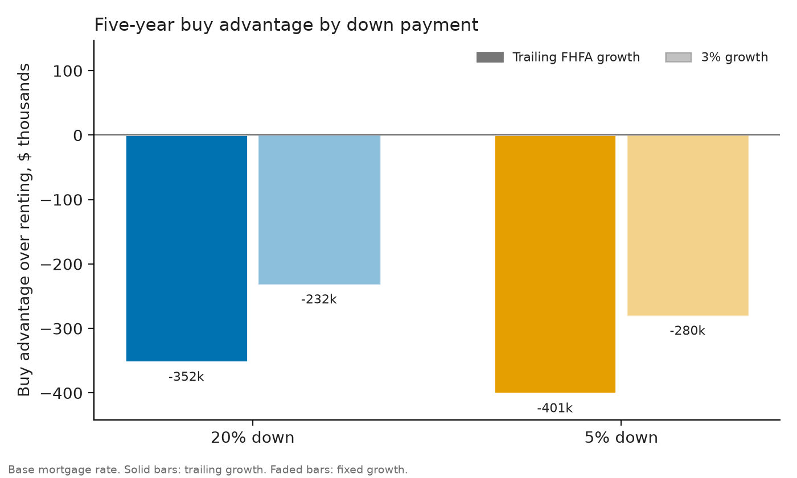
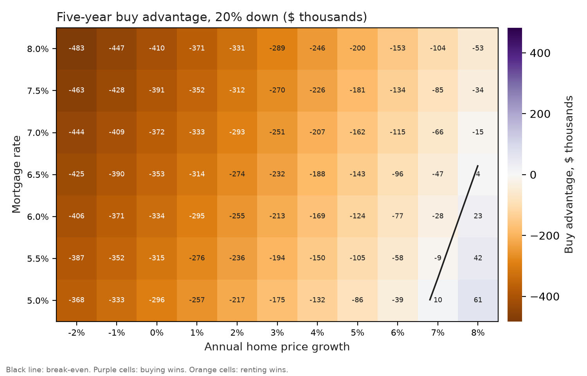

# Rent or buy in Los Angeles County: a five-year decision

**Status:** draft. The mortgage rate in this memo is a placeholder and must be replaced before publishing.

## Recommendation

For a household earning $120,000 a year in Los Angeles County, renting is the better choice over five years. At the median home value and the 6.5% placeholder mortgage rate, buying trails renting by about $352,000 with 20% down and about $401,000 with 5% down. Buying would only break even if home prices rose about 7.9% a year with 20% down, or 8.8% with 5% down. The county's trailing one-year price growth is 0.02%.

The result holds across the rate range tested. Break-even growth with 20% down runs from 6.8% to 9.0% as rates move from 5% to 8%, and with 5% down from 7.6% to 10.1%.

## Decision and options

Over a five-year horizon, should a household earning $120,000 a year rent a comparable home or buy one?

- **A. Rent** a comparable unit.
- **B. Buy** at the county's median home value with 20% down.
- **C. Buy** with 5% down, which adds mortgage insurance and a higher loan amount.

Criteria: net cost over five years, cash needed up front, sensitivity to mortgage rates and price growth, and flexibility if the household needs to move.

## Data and assumptions

- **Home value and rent:** 2024 ACS 1-year estimates for Los Angeles County. Median home value is $866,500 and median gross rent is $2,003 a month.
- **Price growth:** FHFA purchase-only quarterly index for Los Angeles-Long Beach-Glendale (division 31084). Trailing one-year growth is 0.02%.
- **Mortgage rate:** 6.5%, placeholder. [Replace with the current Freddie Mac Primary Mortgage Market Survey rate.]
- **Labeled assumptions:** property tax 1.1% of value a year, insurance 0.35%, maintenance 1%, buyer closing costs 3%, seller costs 6%, PMI 0.75% a year when down payment is under 20%, rent growth 3% a year, and a 4.5% return on invested cash.

The renter invests the cash the buyer would have spent up front, along with any monthly difference between owner costs and rent. Both paths are compared at the end of five years.

## Results

At the base case, the first-month owner cost is about $6,150 with 20% down, which is 62% of gross monthly income. With 5% down it is about $7,490, or 75%. Both exceed the 28% rule of thumb used for the affordability check. Renting costs $2,003, or about 20% of gross income.



*Figure 1. Buy advantage over renting, at the base mortgage rate. Solid bars use trailing growth. Faded bars assume 3% growth, under which buying still trails by about $232,000 with 20% down.*

## Sensitivity



*Figure 2. Buy advantage with 20% down, by mortgage rate and annual price growth. Purple cells favor buying and orange cells favor renting. The black line marks break-even.*

Buying wins only in the top-right corner of the grid: high price growth and low rates. Break-even growth at 20% down is 6.8% a year at a 5% rate and 9.0% at 8%. For context, the trailing one-year growth is 0.02%, and the 3% scenario is still a clear loss for buying.

## Limitations

- **Comparability.** The ACS median home value covers all owner-occupied homes, not a comparable unit. The median rent includes utilities, but the owner cost does not.
- **Assumed costs drive the result.** Maintenance, property tax, and insurance are assumptions, not sourced figures. The memo is more sensitive to price growth and the mortgage rate than to these inputs, but they are not tested in the grid.
- **PMI overstated.** PMI runs for the full five years in the model. It usually ends at 80% loan-to-value, so the 5% down-payment cost is slightly overstated.
- **No tax treatment.** Mortgage interest and property tax deductions, capital gains, and rent-to-own options are not modeled.
- **Geography.** FHFA publishes a metropolitan division, not the full five-county metro. The division is treated as Los Angeles County, to match the ACS county data.
- **Horizon.** Five years favors renting, because closing and selling costs take time to recover. A longer horizon would change the answer.
- **Single household.** The result assumes $120,000 of income and the stated down payments. It is not personal financial advice.

## Appendix: reproducing the analysis

```
python src/fetch_acs.py --county-fips 06037 --year 2024
python src/fetch_fhfa.py --cbsa 31084
python src/model.py --mortgage-rate 0.065 --acs data/raw/acs_2024_06037.json --fhfa data/raw/fhfa_hpi_31084.json
python src/sensitivity.py --acs data/raw/acs_2024_06037.json --fhfa data/raw/fhfa_hpi_31084.json
python src/figures.py --acs data/raw/acs_2024_06037.json --fhfa data/raw/fhfa_hpi_31084.json --mortgage-rate 0.065
```

Sources: American Community Survey 1-year estimates, tables B25077 and B25064, via the Census API; FHFA House Price Index master file, purchase-only quarterly metro series; Freddie Mac Primary Mortgage Market Survey, to be added.
